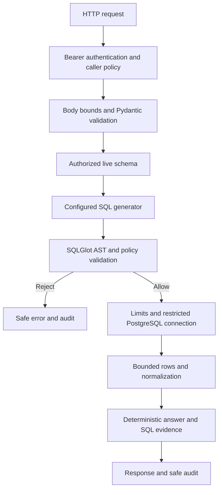

# Architecture

This is an independent structured-data tool for your existing document RAG system.
It does not need embeddings or a vector store to query the Olist relational tables.
The first version uses a fixed schema contract plus live, permission-filtered metadata.

## Components

| Component | Responsibility |
|---|---|
| `app/config.py` | Typed secret settings, required credentials, compatible dialect/role checks, provider URL checks |
| `app/middleware.py` | Server-generated request ID, authenticate before parsing, fixed caller policy, 16 KiB body cap, response headers, structured safe audit |
| `app/models.py` | Strict request and response types; no raw SQL or role fields |
| `app/policy.py` | View/column/type contract, role policy, approved logical joins and metric definitions |
| `app/database.py` | Engine pools, startup privilege checks, authorized live metadata, read-only transactions and bounded result fetching |
| `app/generators.py` | Generator interface, complete-phrase deterministic placeholder, optional API adapter |
| `app/security.py` | Single-statement parsing, fail-closed AST allowlist, object/column/function/join authorization, complexity limits, canonical execution SQL |
| `app/service.py` | Query admission and lifecycle orchestration; generation never directly executes SQL |
| `app/results.py` | Result type/size verification, exact decimal serialization, grounded answer formatting |
| `app/main.py` | Routes, lifespan resource management, safe error handlers, OpenAPI authentication documentation |
| `db/` | Administrator-only schema, fixture, view, role and verification scripts |

## Request lifecycle

1. The ASGI boundary assigns a fresh UUID. Every `/api/` request must authenticate before JSON validation.
2. A token maps to `Principal(subject, role)`; permissions are resolved on the server, never from body fields.
3. The request body is bounded, parsed and validated. Extra fields are rejected.
4. The query service acquires a per-process capacity slot; a full service returns 429.
5. A restricted database login retrieves columns only for the policy's approved analytics views.
6. Live names and built-in types must exactly match the approved contract. Drift fails closed.
7. Server configuration selects the placeholder or API generator; callers cannot change strategies.
8. The generator returns an untrusted `Candidate(sql, strategy, intent)`.
9. SQLGlot parses PostgreSQL SQL. A separate policy validator checks structure, references, functions and joins.
10. The validated AST gets an enforced limit and is serialized to canonical PostgreSQL SQL.
11. The executor requires a `ValidatedQuery` and independently checks its source views against caller policy.
12. SQLAlchemy Core selects the caller's dedicated psycopg 3 login. A transaction is explicitly READ ONLY,
    its search path is `pg_catalog`, standard string handling is enabled, and local timeouts apply.
13. A server-side cursor fetches at most the response row cap plus one lookahead row.
14. The normalizer checks result shape, finite values and size; decimal values preserve precision.
15. The answer builder describes the actual returned rows, handles null/empty results and signals truncation.
16. The response includes executed SQL, source views, rows, limits, strategy, warnings and request ID.
17. The boundary emits one JSON audit event with safe operational fields. Failures return generic error envelopes.
18. The capacity slot and database transaction are released on both success and failure.

## Database access boundary

Only `Database` owns connections. Generated SQL never goes into a setup/admin connection.
The API holds two independent small pools, one per restricted policy. It never holds `saianish`
administrator credentials. Pool connections are closed/disposed at shutdown, and connection/setup
errors are sanitized. The API binds loopback by default in the documented startup command.

Views are owned by the trusted data owner. They intentionally use PostgreSQL's default view-owner
permission behavior rather than `security_invoker`, so restricted callers need no base-table SELECT.
They use explicit columns and `security_barrier=true`; the current views impose no tenant row filter.
Customer IDs/unique IDs, city/ZIP data, geolocation and review free text are excluded from the
approved interface. Order/product/seller IDs, seller state, product category and selected measures remain.

Metadata retrieval is a trusted, parameter-bound `information_schema.columns` query, separate from
generated SQL. System catalogs are used only by trusted startup/permission checks; generated queries
cannot access them. Known logical relationships come from `policy.py`, not from model guesses.
The imported schema does not have to gain foreign keys to run. The scripts do not infer or enforce
referential integrity of your previously imported CSVs.

## Authorization model

| Caller policy | PostgreSQL login | Approved views | Data scope |
|---|---|---|---|
| sales | sql_rag_sales | orders, order_items, products, sellers | All rows in these views |
| analyst | sql_rag_analyst | sales views plus reviews | All rows in these views |

These are resource/column scopes, **not tenant or per-seller row scopes**. A sales caller may see
all exposed sellers' revenue. Do not deploy for mutually untrusted merchants without adding row
authorization to the database/view design and testing it with independent credentials.

The table/column contract is applied twice: before generation through schema filtering, and after
generation through AST validation. Database grants provide another boundary. Startup rejects role
memberships, privileged flags, unexpected non-system table privileges, database CREATE/TEMP,
user-schema CREATE and incompatible view/type contracts. New views do not automatically gain SELECT.

## SQL validation strategy

The validator permits a small **positive subset**, not “anything starting with SELECT.”
It supports one flat SELECT, up to two approved INNER/LEFT equality joins, WHERE, GROUP BY,
HAVING, ORDER BY, a positive integer LIMIT, simple comparisons/boolean/numeric arithmetic,
and COUNT/SUM/AVG/MIN/MAX/ROUND/COALESCE/DATE_TRUNC (day, month, year).

Tables must use the `analytics` schema with unique explicit aliases. Input columns must be
table-qualified and authorized. Unique projected aliases may be used in ORDER BY only. Projection
names must be valid lowercase identifiers. Wildcards are rejected except the direct argument in
COUNT(*). Comments, quoted identifiers, unsupported AST node types, stacked statements, CTEs,
subqueries, unions, windows, explicit casts, catalog references, side-effect functions, offsets,
locking/SELECT INTO clauses and unapproved joins are rejected. Maxima: 12,000 SQL characters,
250 AST nodes, depth 24, 3 source views and 20 output columns.

SQLGlot may make a safe dialect rewrite while serializing approved operations; for example,
ROUND(AVG(...),2) emits an internal DECIMAL cast for PostgreSQL compatibility. Caller-written casts
remain outside the accepted AST subset. Dependency versions are pinned because AST behavior is
part of the security boundary. Extend the node allowlist only with dedicated acceptance/rejection
tests and PostgreSQL integration checks.

The validator authorizes join endpoints and prevents self/cross joins and mixed reviews+items fanout.
It does not prove aggregate correctness, valid GROUP BY semantics, all cardinality issues, or NL-to-SQL
equivalence. PostgreSQL may still reject an authorized query for type/grouping errors; the API returns
a safe `QUERY_EXECUTION_FAILED` response. The placeholder's known semantics have fixture assertions
in the integration suite. Arbitrary model-generated semantics need an evaluation dataset and review.

## Limits and results

The default row cap is 100, server configurable up to 1000. A caller can request a smaller cap.
The AST receives a cap plus one lookahead row, unless a smaller candidate limit already exists.
Rows after the response cap are discarded and `truncated=true` is reported if lookahead succeeded.
This bounds returned rows, not aggregate scan cost; statement/lock timeouts bound database work.

Each query transaction sets a 3-second default statement timeout (configuration permits 0.1–10
seconds), a 500 ms lock timeout and a 5-second idle transaction timeout. Pools have connection
timeouts. Query concurrency defaults to four per process. The model adapter has connect/read
timeouts, caps provider output bytes and never automatically retries. These are per-process/query
budgets, not a complete distributed load/rate-control system.

Normalized rows are limited to 1 MB in total and 2000 characters per returned string value. Results
with unsupported/non-finite values fail explicitly. These limits bound serialization; values already
arrived from PostgreSQL, so this is not a byte-level streaming database transfer limit.

## Future local LLM integration

Replace the generator implementation or point the API adapter at a compatible local loopback server.
No other component should depend on the model SDK or runtime. The local generator receives only
authorized metadata and returns an untrusted SQL candidate. Running a local model does not remove
the need for authorization or validation. Server code, policies, roles, parser, result normalization
and tests remain unchanged. Keep model/runtime-specific dependencies in an optional adapter extra.

## Combining with document RAG

Add a routing layer above the independent services. A structured-data question calls this API;
a document question invokes your DOCX/PDF/TXT retriever. A hybrid question can call both under the
same trusted user identity. Treat document/model output as untrusted. Do not forward a document's
claimed roles, connection strings or SQL directly to an executor. Carry the SQL request ID and
structured evidence alongside document chunk citations; report partial failures without fabricating
either source. Cross-source answer synthesis is intentionally outside this initial backend.
